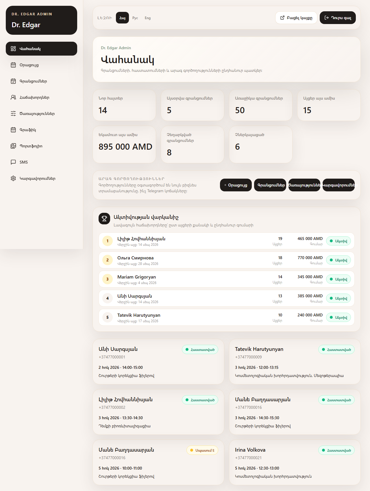
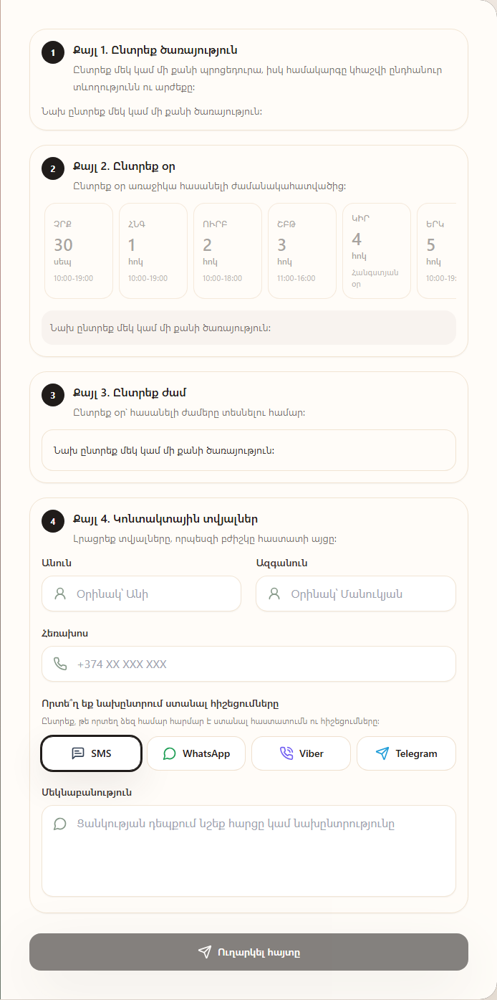
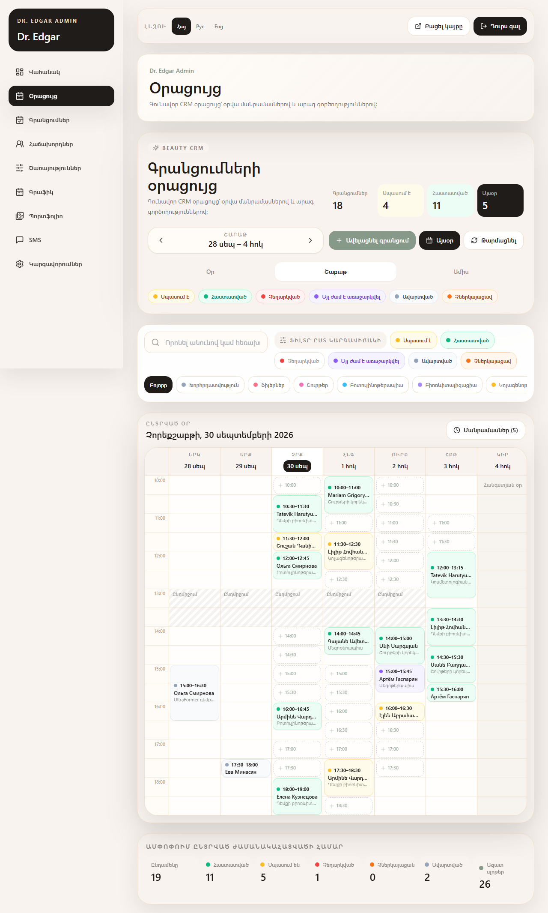
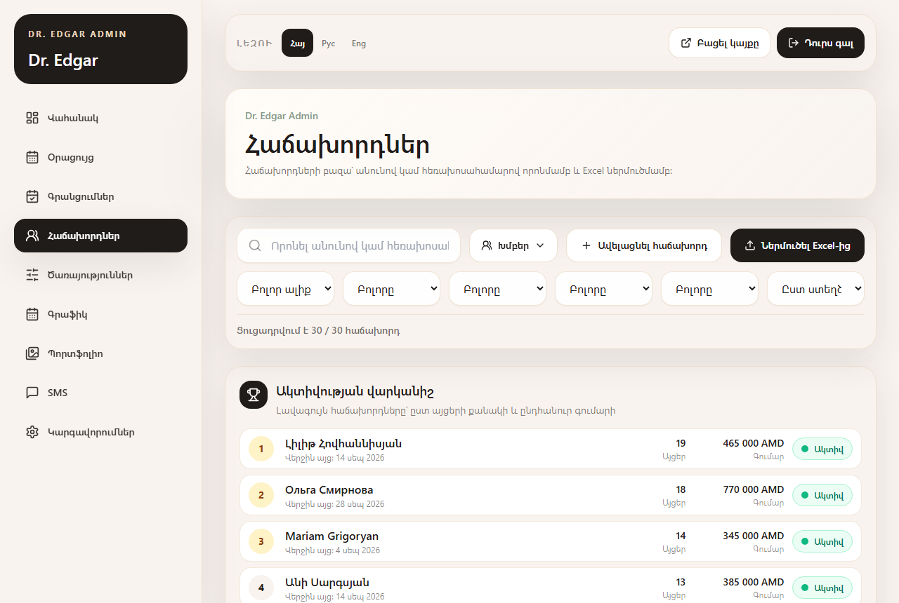
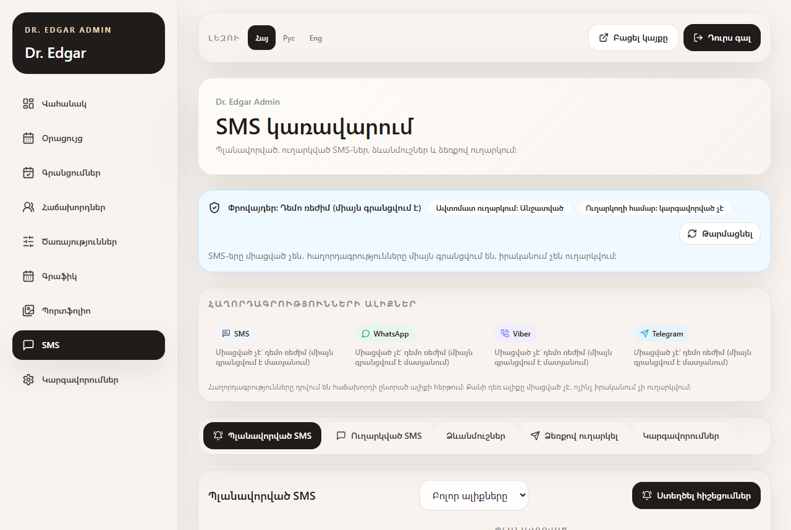

# Dr. Edgar — առցանց գրանցում և CRM կոսմետոլոգի համար

**Հայերեն** · [English](README.md)

Առցանց գրանցման կայք և փոքր CRM համակարգ բժիշկ-կոսմետոլոգի համար։
Հաճախորդը կայքում ընտրում է ծառայությունները, օրը և ազատ ժամը, իսկ բժիշկը
ադմինիստրատորի վահանակից (կամ Telegram-ից) հաստատում, տեղափոխում կամ չեղարկում է
հայտը, վարում է հաճախորդների քարտերը՝ պրոցեդուրաներով, նշումներով և լուսանկարներով,
և ուղարկում է հիշեցումներ այն ալիքով, որը նախընտրում է հաճախորդը։ Լռելյայն լեզուն
հայերենն է, ամբողջ ինտերֆեյսը հասանելի է նաև ռուսերենով և անգլերենով։

> Սքրինշոթներում բոլոր տվյալները **դեմո** են՝ 30 հորինված հաճախորդ
> `+37477000001 … +37477000030` հեռախոսահամարներով, ստեղծված `npm run demo:setup` հրամանով։



## Բովանդակություն

- [Հնարավորություններ](#հնարավորություններ)
- [Սքրինշոթներ](#սքրինշոթներ)
- [Արագ մեկնարկ](#արագ-մեկնարկ-windows-macos-linux)
- [Դեմո մուտք](#դեմո-մուտք)
- [Թեստեր](#թեստեր)
- [Տեխնոլոգիաներ](#տեխնոլոգիաներ)
- [Ճարտարապետություն](#ճարտարապետություն)
- [Անվտանգություն](#անվտանգություն)
- [Ինչպես է օգտագործվել AI-ը](#ինչպես-է-օգտագործվել-ai-ը)
- [Զարգացման պլաններ](#զարգացման-պլաններ)

## Հնարավորություններ

**Կայք և առցանց գրանցում**
- Ծառայություններ՝ տևողությամբ և գնով․ մեկ այցում կարելի է ընտրել մի քանի պրոցեդուրա,
  ընդհանուր տևողությունն ու արժեքը հաշվվում են ավտոմատ։
- Առաջարկվում են միայն իրականում ազատ ժամերը՝ հաշվի առնելով աշխատանքային ժամերը,
  ընդմիջումները, արգելափակված ժամանակահատվածները, առկա գրանցումները, նվազագույն
  նախապես գրանցվելու ժամանակը և (ցանկության դեպքում) Google Calendar-ի զբաղված ժամերը։
  Ամեն ինչ հաշվվում է կլինիկայի ժամային գոտում (`Asia/Yerevan`)։
- Անցած ժամին գրանցվել հնարավոր չէ։ Եթե երկու հաճախորդ միաժամանակ գրանցվում են նույն
  ժամին, մեկը գրանցվում է, իսկ մյուսը ստանում է հստակ պատասխան, որ ժամն արդեն զբաղված է
  (HTTP 409)։
- Հաճախորդն ընտրում է, թե որտեղ ստանալ հիշեցումները՝ SMS, WhatsApp, Viber կամ Telegram։
- Հայերեն, ռուսերեն և անգլերեն․ ընտրված լեզուն պահպանվում է։

**Ադմինիստրատորի վահանակ** (`/admin`)
- Վահանակ՝ նոր հայտեր, այսօրվա և առաջիկա գրանցումներ, այս ամսվա այցերն ու եկամուտը,
  չեղարկումներ, չներկայացածներ և **ակտիվության վարկանիշ**՝ լավագույն հաճախորդներն ըստ
  այցերի քանակի և ընդհանուր գումարի։
- Օրացույց՝ **Օր / Շաբաթ / Ամիս** դիտումներով․ ժամային ցանց, գրանցումները՝ ըստ
  կարգավիճակի գույների, ազատ ժամեր (սեղմելով՝ նոր գրանցում), ընդմիջումներ և
  արգելափակումներ, ամփոփում ընտրված ժամանակահատվածի համար։ Հարմար է նաև հեռախոսով։
- Գրանցումներ՝ հաստատել, չեղարկել, տեղափոխել, նշել որպես ավարտված կամ **չներկայացած**
  (թույլատրված են միայն ճիշտ անցումները, այցերի քանակը վերահաշվվում է)։
- Ձեռքով գրանցում՝ հաճախորդի որոնմամբ ըստ անվան, ազգանվան կամ հեռախոսի․ որոնումն
  աշխատում է հայերեն, ռուսերեն և լատինատառ գրությունների միջև (տառադարձում)։ Եթե
  հեռախոսահամարն արդեն կա, հաճախորդն ընտրվում է ավտոմատ, և կրկնօրինակ չի ստեղծվում։
- Հաճախորդներ՝ խմբեր (ակտիվ, քնած, կորած, նոր), VIP, սև ցուցակ, պարտքեր, նախընտրած
  ալիք, վարկանիշի տեղը և «Ակտիվ» նշումը, ներմուծում Excel-ից և արտահանում Excel / Access։
- Հաճախորդի քարտ՝ գրանցումներ, պրոցեդուրաների պատմություն (պատրաստուկ, դեղաչափ, գոտի,
  բժշկի նշումներ), ամրացված նշումներ, «մինչև/հետո» լուսանկարներ (փակ, առանց EXIF
  տվյալների), արտահանում։
- Հաղորդագրություններ՝ ձևանմուշներ, հերթ և մատյան՝ յուրաքանչյուր հաղորդագրության ալիքով,
  յուրաքանչյուր ալիքի կարգավիճակը։ WhatsApp-ը, Viber-ը և Telegram-ը դեմո մատակարարներ են
  (միայն գրառում մատյանում), իրական SMS ուղարկումն անջատված է։
- Ծառայություններ, աշխատանքային գրաֆիկ, ընդմիջումներ և հանգստյան օրեր, պորտֆոլիո,
  կարգավորումներ։
- Telegram բոտ բժշկի համար (ըստ ցանկության)․ նոր հայտերը գալիս են «Հաստատել»,
  «Չեղարկել», «Տեղափոխել» կոճակներով։

## Սքրինշոթներ

| | |
|---|---|
|  Կայքի գլխավոր էջը |  Գրանցման ձևը՝ ալիքի ընտրությամբ |
|  Շաբաթվա դիտում՝ ազատ ժամերով և ամփոփումով |  Ամսվա դիտում |
|  Հաճախորդներ՝ վարկանիշ, խմբեր, ալիքներ |  Հաճախորդի քարտ |
|  Հաղորդագրությունների հերթ և մատյան |  Օրվա դիտում հեռախոսում |

Մյուս սքրինշոթները՝ [docs/screenshots](docs/screenshots) թղթապանակում։ Դրանք կարելի է
թարմացնել `node scripts/take-screenshots.mjs <url>` հրամանով՝ դեմո տվյալներով աշխատող
սերվերի վրա։

## Արագ մեկնարկ (Windows, macOS, Linux)

Անհրաժեշտ է՝ **Node.js 20.9 կամ ավելի նոր** (ստուգված է Node.js 24-ով) և npm, ինչպես նաև
Git՝ պահոցը ներբեռնելու համար։

```bash
git clone <repository-url> dr-edgar
cd dr-edgar
npm ci
npm run demo:setup   # ստեղծում է դեմո տվյալներ storage/ թղթապանակում (կարելի է կրկնել)
npm run build
npm start            # http://localhost:3000
```

Հրամանները նույնն են PowerShell-ում, cmd-ում, bash-ում և zsh-ում։ `.env.local` ֆայլ պետք
չէ․ առանց դրա հավելվածն աշխատում է **դեմո ռեժիմով**՝ ադմինիստրատորի վահանակը բացվում է
դեմո գաղտնաբառով, և ոչինչ ոչ մի տեղ չի ուղարկվում (ո՛չ Telegram, ո՛չ Google Calendar,
SMS-ները միայն գրանցվում են մատյանում)։

Մշակման համար՝ ավտոմատ թարմացմամբ, `build` + `start`-ի փոխարեն օգտագործեք `npm run dev`։

`npm run demo:setup`-ը փոխարինում է հաճախորդներին, գրանցումները, նշումները,
պրոցեդուրաները, հաճախորդների լուսանկարները և հաղորդագրությունների հերթն ու մատյանը՝
թարմ դեմո տվյալներով՝ այսօրվա ամսաթվի շուրջ։ Նախ ընթացիկ տվյալները պատճենվում են
`storage/snapshots/before-demo-<ժամանակ>/` թղթապանակ։ Գործարկելուց առաջ կանգնեցրեք սերվերը։

### Կարգավորում

Պատճենեք `.env.example`-ը `.env.local` անունով և լրացրեք անհրաժեշտ արժեքները․ բոլոր
փոփոխականները այնտեղ մեկնաբանված են։ Կարևորները՝

| Փոփոխական | Նշանակություն |
|---|---|
| `ADMIN_PASSWORD` | Ադմինիստրատորի գաղտնաբառ։ Այն նշելուց հետո դեմո գաղտնաբառն անջատվում է։ |
| `ADMIN_SESSION_SECRET` | Սեսիաների թոքենների հեշավորման բանալի (պատահական տող)։ |
| `CLINIC_TIMEZONE` | Կլինիկայի ժամային գոտին, լռելյայն՝ `Asia/Yerevan`։ |
| `TELEGRAM_BOT_TOKEN`, `TELEGRAM_CHAT_ID`, `TELEGRAM_WEBHOOK_SECRET` | Telegram բոտ բժշկի համար (ըստ ցանկության)։ |
| `GOOGLE_CALENDAR_ENABLED` և `GOOGLE_*` | Google Calendar-ի հետ համաժամեցում (ըստ ցանկության)։ |
| `SMS_PROVIDER`, `SMS_AUTO_SEND_ENABLED` | `mock`-ը միայն գրանցում է մատյանում։ Իրական ուղարկման համար պետք են մատակարար **և** երկու անջատիչներն էլ։ |

## Դեմո մուտք

- Ադմինիստրատորի վահանակ՝ <http://localhost:3000/admin/login>
- Գաղտնաբառ՝ **`demo-edgar`** (դեմո ռեժիմում ցուցադրվում է մուտքի էջում)

Դեմո ռեժիմը գործում է միայն այն դեպքում, երբ `ADMIN_PASSWORD`-ը դատարկ է **և** ոչ մի իրական
ինտեգրացիա (Telegram թոքեն, Google Calendar, ոչ mock SMS մատակարար) կարգավորված չէ։
`DEMO_MODE=false`-ը այն անջատում է բացահայտ։ Այսպիսով, իրական տեղակայումը երբեք չի ընդունի
դեմո գաղտնաբառը։

## Թեստեր

```bash
npm run lint         # ESLint
npm run typecheck    # TypeScript
npm run test         # unit թեստեր (Vitest)
npx playwright install chromium   # մեկ անգամ՝ յուրաքանչյուր համակարգչում
npm run test:e2e     # կառուցում է նախագիծը և գործարկում բրաուզերային թեստերը (Playwright)
```

- **Unit թեստեր** (Vitest, ~90)՝ կլինիկայի ժամային գոտի և ամսաթվեր, հեռախոսահամարների
  ձևաչափում, ազատ ժամերի հաշվարկ (`getAvailability`՝ աշխատանքային ժամեր, ընդմիջումներ,
  արգելափակումներ, գրանցումներ, Google-ի զբաղված ժամեր, նախապես գրանցվելու ժամանակ,
  հորիզոն, 409), հաղորդագրությունների ձևանմուշներ, որոնում տառադարձմամբ, հաճախորդների
  խմբեր, ակտիվության վարկանիշ, վահանակի ցուցանիշներ, օրացույցի ամփոփում, դեմո տվյալների
  ճշտություն, հարցումների սահմանափակում, սխալների տեքստեր, 401-ի վերահղում և դեմո ռեժիմի
  պաշտպանություն։
- **Բրաուզերային թեստեր** (Playwright, Chromium)՝ հաճախորդի գրանցում, անցած ժամի արգելք,
  կրկնակի գրանցում → 409, ադմինիստրատորի մուտք, հաստատում / չեղարկում / չներկայացած,
  օրացույց Օր / Շաբաթ / Ամիս, ձեռքով գրանցում՝ հաճախորդի որոնմամբ, պորտֆոլիոյի
  լուսանկարի փոխարինում, նախընտրած ալիք, ավարտված սեսիա, երեք լեզուները կայքում և
  վահանակում, անվտանգության վերնագրեր, հարցումների սահմանափակում և արգելափակման
  պատճառի թաքցում։
  Սքրինշոթները պահվում են `test-results/screenshots` թղթապանակում։
- Բրաուզերային թեստերը գործարկում են կառուցված հավելվածը **ժամանակավոր պատճենից**՝
  սինթետիկ տվյալներով (`e2e/server.mjs`)․ ձեր `storage/`-ին չեն դիպչում, իսկ Telegram-ը,
  Google-ը և SMS-ը ստիպողաբար անջատված են։ 3210 պորտը պետք է ազատ լինի։

## Տեխնոլոգիաներ

- **Next.js 16** (App Router, route handlers), **React 19**, **TypeScript 5**
- **Tailwind CSS 3**, lucide-react պատկերակներ
- **Zod**՝ հարցումների ստուգման համար
- **ExcelJS** և **archiver**՝ ներմուծման և արտահանման համար
- **Vitest** և **Playwright**՝ թեստերի համար
- Պահոց՝ JSON ֆայլ (`storage/app-data.json`)․ մեկ բժշկի համար բավարար է, տվյալների բազա
  տեղադրել պետք չէ

## Ճարտարապետություն

```
src/
  app/                 էջեր (կայք, /admin/*) և API route handler-ներ (/api/*)
  components/          կայքի և վահանակի ինտերֆեյս
  lib/
    availability/      ազատ ժամերի հաշվարկ
    bookings/          գրանցում, հաստատում, չեղարկում, տեղափոխում, չներկայացած, վիճակագրություն
    clients/           որոնում տառադարձմամբ, խմբեր և վարկանիշ, ներմուծում/արտահանում
    messaging/ sms/    ալիքների գրանցամատյան, մատակարարներ, հերթ և ձևանմուշներ
    telegram/ google/  ըստ ցանկության ինտեգրացիաներ
    repositories/      տվյալների հասանելիություն JSON պահոցի վրա
    time/              կլինիկայի ժամային գոտի
    i18n/              hy / ru / en բառարաններ և ամսաթվերի ձևաչափում
    demo/              դեմո տվյալների գեներատոր
  types/               տիրույթի տիպեր
e2e/                   Playwright թեստեր, թեստային տվյալներ, առանձին թեստային սերվեր
scripts/               դեմո տվյալներ, սքրինշոթներ, ներմուծում և սպասարկում
storage/               աշխատանքային տվյալներ և հաճախորդների լուսանկարներ (git-ում չեն)
```

- **Բիզնես տրամաբանությունը մեկ տեղում է։** Վահանակի կոճակները, Telegram-ի կոճակները և
  կայքի ձևը կանչում են `lib/bookings`-ի նույն ֆունկցիաները, ուստի կանոնները չեն
  տարբերվում։
- **Տվյալների ամբողջականություն։** Փոփոխությունները կատարվում են հերթով և ատոմար (ժամանակավոր
  ֆայլ + վերանվանում)։ Ժամի ստուգումը և պահպանումը կատարվում են մեկ գործողությամբ․ դրա
  շնորհիվ է կրկնակի գրանցման թեստը ստանում 409։
- **Ժամային գոտի։** «Այսօրը», ազատ ժամերը և հիշեցումները հաշվվում են կլինիկայի գոտում,
  ոչ թե սերվերի կամ բրաուզերի։
- **Մատակարարների գրանցամատյան։** Յուրաքանչյուր ալիք իրականացնում է նույն ինտերֆեյսը․
  հաղորդագրությունը դրվում է հաճախորդի ալիքի հերթում, և մատակարարն է որոշում՝ կարո՞ղ է
  արդյոք իրականում ուղարկել։
- **Մաքուր և թեստավորված հաշվարկներ։** Խմբերը, վարկանիշը և բոլոր ցուցանիշները մաքուր
  ֆունկցիաներ են, որոնք օգտագործում են և՛ էջերը, և՛ թեստերը։

## Անվտանգություն

- Ադմինիստրատոր՝ գաղտնաբառը միջավայրի փոփոխականից (դեմո ռեժիմից դուրս լռելյայն գաղտնաբառ
  չկա), սեսիան՝ httpOnly cookie-ում, թոքենները պահվում են միայն HMAC հեշի տեսքով, մուտքի
  փորձերի քանակը սահմանափակված է։
- Հաճախորդների լուսանկարները պահվում են `public/`-ից դուրս և հասանելի են միայն
  ադմինիստրատորին․ վերբեռնելիս EXIF տվյալները (GPS, սարք) հեռացվում են։
- Հանրային գրանցման API-ն վերադարձնում է միայն հանրային դաշտեր․ արգելափակված
  ժամանակահատվածները հրապարակվում են առանց պատճառի, իսկ անհայտ սխալները գրանցվում են
  սերվերում, և պատասխանում ցուցադրվում է ընդհանուր տեքստ։
- Հարցումների սահմանափակում՝ 10 գրանցման հայտ 10 րոպեում, 60 ազատ ժամերի հարցում րոպեում
  (HTTP 429՝ `Retry-After`-ով), ադմինիստրատորի մուտքի 5 անհաջող փորձ 15 րոպեում։
- Անվտանգության վերնագրեր բոլոր պատասխաններում՝ `X-Frame-Options: DENY` և CSP
  `frame-ancestors 'none'`, `nosniff`, խիստ referrer քաղաքականություն, HSTS․ վահանակն ու API-ն
  փակ են որոնողական համակարգերի համար, իսկ API-ի պատասխանները չեն քեշավորվում։
- Telegram webhook-ը պահանջում է գաղտնի թոքեն, իսկ իրական SMS ուղարկումը՝ բացահայտ
  միացում։
- Աշխատանքային տվյալները (`storage/`), վերբեռնումները և `.env*` ֆայլերը git-ում չեն։
- Դեմո տվյալներում իրական մարդիկ չկան՝ հորինված անուններ, `+37477000001…030`,
  `example.com` էլ. հասցեներ, լուսանկարների փոխարեն՝ գեներացված վերացական պատկերներ։

## Ինչպես է օգտագործվել AI-ը

Նախագիծը ստեղծել է մեկ ծրագրավորող՝ AI գործիքների հետ միասին, և ես դա չեմ թաքցնում․

- **Codex**՝ նախնական փուլում․ գրանցման գործընթացի և վահանակի էջերի առաջին տարբերակները։
- **Claude Code**՝ հետագա աշխատանքի մեծ մասը, հաճախ՝ երկար ինքնավար աշխատանքային
  սեսիաներով՝ գրավոր առաջադրանքների ցանկով․ կոդի ամբողջական աուդիտ
  ([AUDIT_REPORT.md](AUDIT_REPORT.md)), անվտանգության և գրանցման ուղղումներ, ժամային գոտի,
  օրացույց, «չներկայացած» կարգավիճակ, որոնում տառադարձմամբ, ամբողջական hy/ru/en թարգմանություն,
  հաղորդագրությունների ալիքներ, Playwright և Vitest թեստեր, դեմո տվյալներ և այս README-ն։
  Որոշումներն ու ստուգումները գրանցված են [NIGHT_LOG.md](NIGHT_LOG.md) ֆայլում (ռուսերեն)։
- **Claude** (զրույց)՝ պահանջների քննարկում, հայերեն և ռուսերեն տեքստերի ձևակերպում,
  պլանների վերանայում։

Յուրաքանչյուր փոփոխություն ստուգվել է lint-ով, տիպերի ստուգմամբ, production կառուցմամբ և
ավտոմատ թեստերով, իսկ հեղինակը արդյունքները վերանայել և փորձարկել է իրական հավելվածում։

## Զարգացման պլաններ

- Իրական SMS մատակարար (տեղական օպերատոր կամ GSM մոդեմ), WhatsApp Business և Viber API-ներ։
- PostgreSQL (օրինակ՝ Prisma-ով) JSON ֆայլի փոխարեն՝ ավելի մեծ կլինիկաների համար։
- Առցանց կանխավճար սև ցուցակի հաճախորդների համար, լոյալության ծրագիր և նվեր քարտեր։
- Մի քանի մասնագետ և սենյակ․ հաճախորդը կարող է ինքը տեղափոխել կամ չեղարկել գրանցումը
  հղումով։
- PWA՝ ծանուցումներով բժշկի համար, և Docker պատկեր՝ մեկ հրամանով տեղակայման համար։
