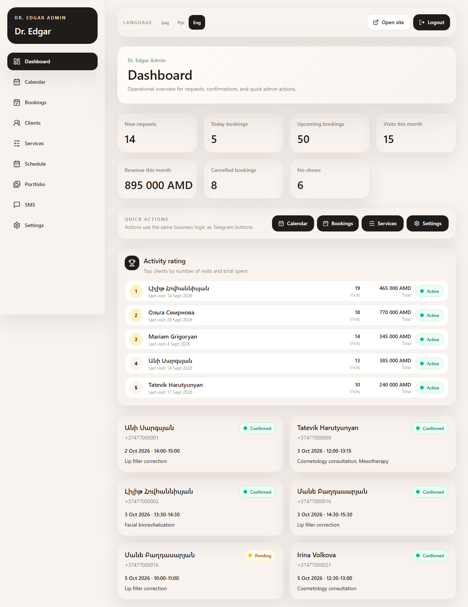
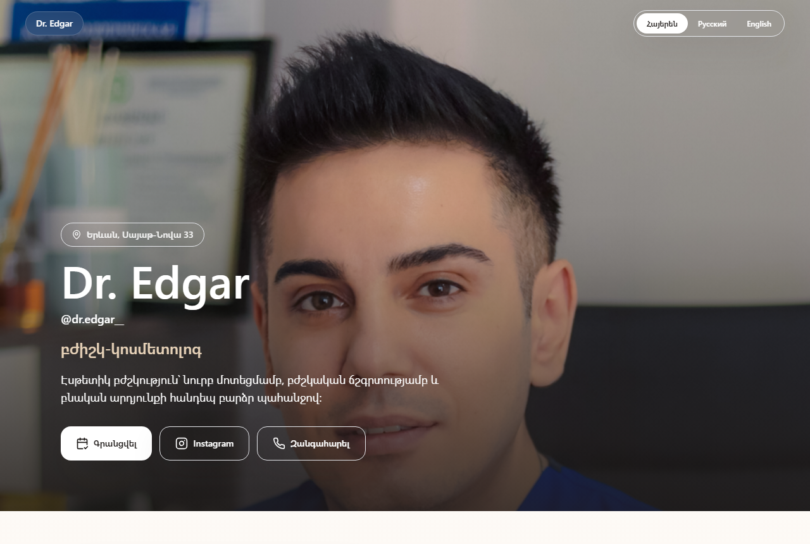
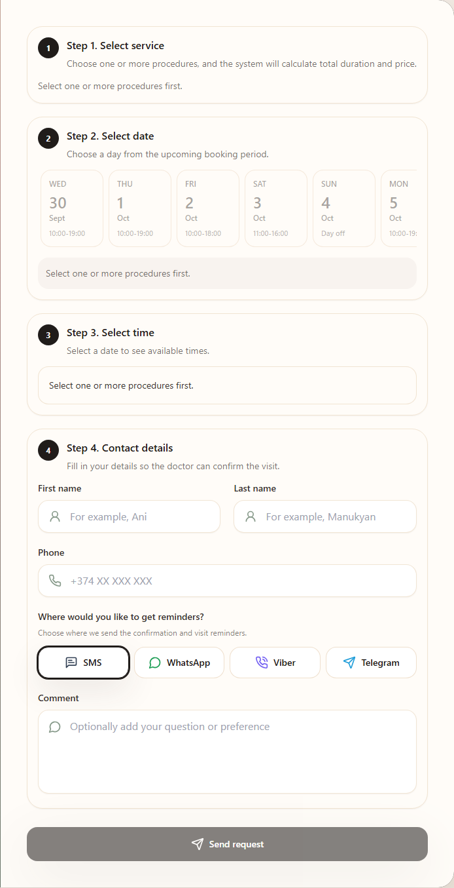
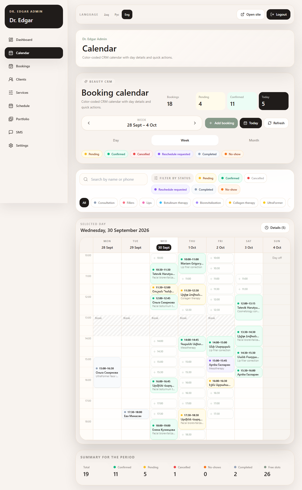
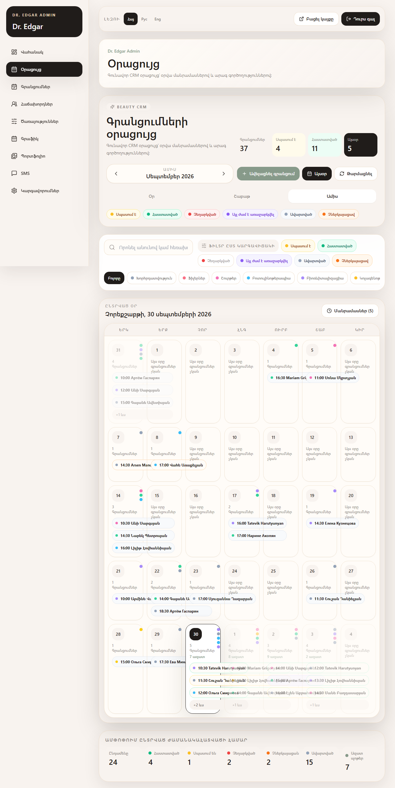
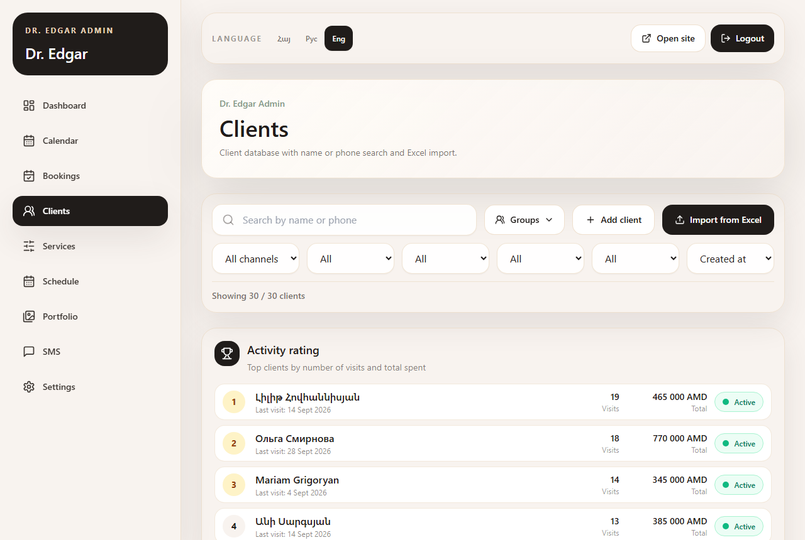
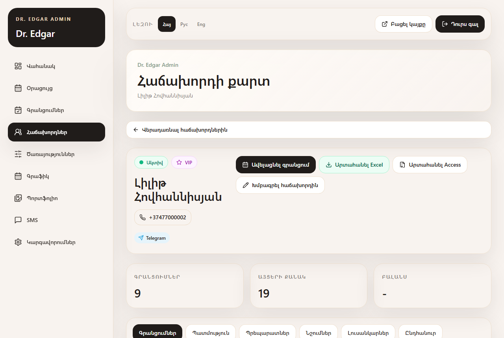
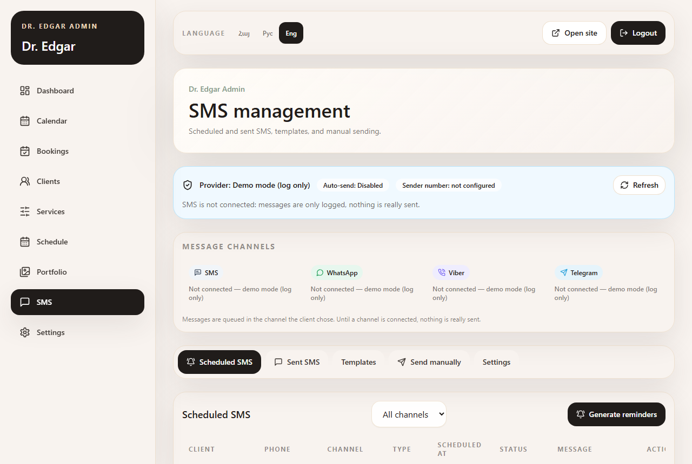
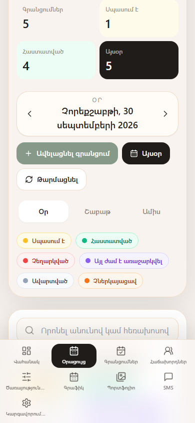
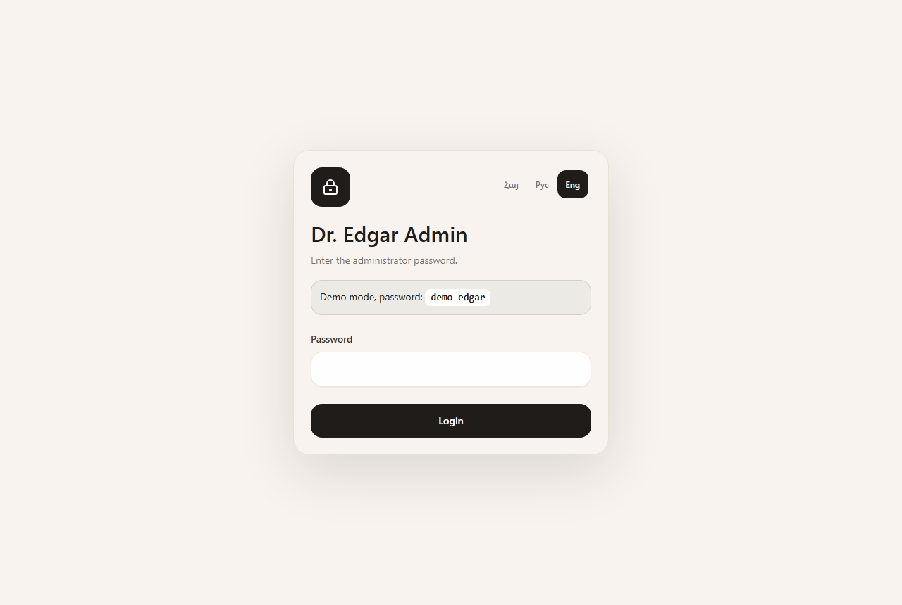

# Dr. Edgar — booking and CRM for a cosmetologist

[Հայերեն](README.hy.md) · **English**

A booking website and a small CRM for one cosmetologist. Clients pick services,
a day and a free time slot on the landing page; the doctor confirms, moves or
cancels the request from the admin panel (or from Telegram), keeps client cards
with procedures, notes and photos, and sends reminders in the channel each
client prefers. Armenian is the default language; Russian and English are
built in everywhere.

> Everything in the screenshots is **demo data**: 30 made-up clients with phones
> `+37477000001 … +37477000030`, generated with `npm run demo:setup`.



## Contents

- [Features](#features)
- [Screenshots](#screenshots)
- [Telegram bot video](#telegram-bot-video)
- [Quick start](#quick-start-windows-macos-linux)
- [Demo login](#demo-login)
- [Tests](#tests)
- [Tech stack](#tech-stack)
- [Architecture](#architecture)
- [Security](#security)
- [How AI was used](#how-ai-was-used)
- [Roadmap](#roadmap)

## Features

**Landing page and online booking**
- Services with duration and price; several procedures in one visit, the total is calculated.
- Only really free slots are offered: working hours, breaks, blocked periods, existing
  bookings, minimum notice and (optionally) Google Calendar busy times, all in the clinic
  time zone (`Asia/Yerevan`).
- Past times cannot be booked; two clients booking the same slot at once — one wins, the
  other gets a clear "slot is taken" (HTTP 409).
- The client chooses where to get reminders: SMS, WhatsApp, Viber or Telegram.
- Armenian / Russian / English, remembered per browser.

**Admin panel** (`/admin`)
- Dashboard: new requests, today, upcoming, visits and revenue this month, cancellations,
  no-shows, and the **activity rating** — top clients by number of visits and total spent.
- Calendar with **Day / Week / Month** views: hourly grid, bookings coloured by status, free
  slots (click one to book), breaks and blocked time, a summary for the period. Works on a phone.
- Bookings: confirm, cancel, reschedule, mark as completed or **no-show** (only valid status
  transitions are allowed; visit counters are recalculated).
- Manual booking with client search by first name, last name or phone that works across
  Armenian, Russian and Latin spelling (transliteration); an existing phone number selects
  the client automatically, so no duplicates are created.
- Clients: segments (active, sleeping, lost, new), VIP, blacklist, debtors, preferred
  channel; rating place and "Active" mark; import from Excel and export to Excel / Access.
- Client card: bookings, procedure history (preparation, dose, area, doctor's notes),
  pinned notes, before/after photos (private, EXIF stripped), per-client export.
- Messages: templates, queue and log with the channel of every message, per-channel status.
  WhatsApp, Viber and Telegram are demo providers (log only); real SMS sending is off.
- Services, working hours, breaks and blocked days, portfolio, settings.
- Telegram bot for the doctor (optional): new requests arrive with confirm / cancel /
  reschedule buttons.

## Screenshots

| | |
|---|---|
|  Landing page (Armenian) |  Booking form with channel choice |
|  Week view with free slots and the period summary |  Month view (Armenian) |
|  Clients: rating, segments, channels |  Client card (Armenian) |
|  Message queue and log by channel |  Day view on a phone |

More in [docs/screenshots](docs/screenshots). They are regenerated with
`node scripts/take-screenshots.mjs <url>` against a server running the demo data.

## Telegram bot video

[▶ Watch the demo: docs/videos/telegram-demo.mp4](docs/videos/telegram-demo.mp4) (5 min, 22 MB)

A client books on the site, the request arrives in the doctor's Telegram chat, and the doctor
confirms it with a button; then a walk through the admin panel.

## Quick start (Windows, macOS, Linux)

Requirements: **Node.js 20.9 or newer** (tested with Node.js 24) and npm. Git for cloning.

```bash
git clone <repository-url> dr-edgar
cd dr-edgar
npm ci
npm run demo:setup   # creates demo data in storage/ (safe to run again)
npm run build
npm start            # http://localhost:3000
```

The commands are the same in PowerShell, cmd, bash and zsh. No `.env.local` is needed:
without it the app runs in **demo mode** — the admin opens with the demo password and
nothing is sent anywhere (no Telegram, no Google Calendar, SMS only written to the log).

For development with hot reload use `npm run dev` instead of `build` + `start`.

`npm run demo:setup` replaces clients, bookings, notes, procedures, client photos and the
message queue/log with fresh demo data dated around today. It first copies the current
data to `storage/snapshots/before-demo-<time>/`. Stop the server before running it.

### Configuration

Copy `.env.example` to `.env.local` and fill in what you need; every variable is commented
there. The important ones:

| Variable | Meaning |
|---|---|
| `ADMIN_PASSWORD` | Admin password. Setting it turns the demo password off. |
| `ADMIN_SESSION_SECRET` | Key for hashing session tokens (random string). |
| `CLINIC_TIMEZONE` | Clinic time zone, `Asia/Yerevan` by default. |
| `TELEGRAM_BOT_TOKEN`, `TELEGRAM_CHAT_ID`, `TELEGRAM_WEBHOOK_SECRET` | Optional Telegram bot for the doctor. |
| `GOOGLE_CALENDAR_ENABLED` and `GOOGLE_*` | Optional Google Calendar sync (service account). |
| `SMS_PROVIDER`, `SMS_AUTO_SEND_ENABLED` | `mock` only logs. Real sending needs a provider **and** both switches. |

## Demo login

- Admin: <http://localhost:3000/admin/login>
- Password: **`demo-edgar`** (shown on the login page in demo mode)

Demo mode is active only while `ADMIN_PASSWORD` is empty **and** no real integration
(Telegram token, Google Calendar, a non-mock SMS provider) is configured. `DEMO_MODE=false`
turns it off explicitly. A real deployment therefore never accepts the demo password.



## Tests

```bash
npm run lint         # ESLint
npm run typecheck    # TypeScript
npm run test         # unit tests (Vitest)
npx playwright install chromium   # once per machine
npm run test:e2e     # builds, then runs the browser tests (Playwright)
```

- **Unit tests** (Vitest, ~90): clinic time zone and date helpers, phone normalisation, free
  slots (`getAvailability`: hours, breaks, blocks, bookings, Google busy time, notice, horizon,
  409 vs unavailable), message templates, transliterating client search, client segments,
  activity rating, dashboard counters, calendar summary, demo-data invariants, rate limits,
  error texts, the admin 401 redirect and the demo-mode guard.
- **Browser tests** (Playwright, Chromium): booking by a client, past times refused, double
  booking → 409, admin login, confirm / cancel / no-show, calendar Day / Week / Month, manual
  booking with client search, portfolio photo replacement, preferred channel, expired admin
  session, all three languages on the landing page and in the admin, security headers, rate
  limit and hidden blocked-time reasons. Screenshots go to `test-results/screenshots`.
- The browser tests start the built app from a **temporary copy** with synthetic data
  (`e2e/server.mjs`); your `storage/` is never touched and Telegram / Google / SMS are forced
  off. Port 3210 must be free.

## Tech stack

- **Next.js 16** (App Router, route handlers), **React 19**, **TypeScript 5**
- **Tailwind CSS 3**, lucide-react icons
- **Zod** for request validation
- **ExcelJS** and **archiver** for import/export
- **Vitest** and **Playwright** for tests
- Storage: a JSON file (`storage/app-data.json`) — enough for one doctor, no database to install

## Architecture

```
src/
  app/                 pages (landing, /admin/*) and API route handlers (/api/*)
  components/          landing and admin UI
  lib/
    availability/      free-slot calculation (working hours, breaks, blocks, bookings, Google busy)
    bookings/          create / confirm / cancel / reschedule / no-show, status rules, statistics
    clients/           search with transliteration, segments and rating, import/export helpers
    messaging/ sms/    channel registry, providers (mock / demo / future real), queue and templates
    telegram/ google/  optional integrations
    repositories/      data access over the JSON store
    time/              clinic time zone helpers
    i18n/              hy / ru / en dictionaries and date formatting
    demo/              demo data generator
  types/               domain types
e2e/                   Playwright tests, seed data, isolated test server
scripts/               demo setup, screenshots, import and maintenance scripts
storage/               runtime data and client photos (git-ignored)
```

- **One source of business logic.** The admin buttons, the Telegram buttons and the public
  form call the same functions in `lib/bookings`, so rules (valid transitions, visit counters,
  notifications) cannot drift apart.
- **Consistent writes.** The repository serialises updates through a queue and writes
  atomically (temp file + rename). Slot check and save happen in one update, which is what
  makes the double-booking test return 409.
- **Time zone aware.** "Today", slots and reminders are computed in the clinic zone, not in
  the server's or the browser's.
- **Provider registry for messages.** Every channel implements one interface; a message is
  queued in the client's channel and the provider decides whether it can really deliver.
- **Pure, tested calculations.** Segments, the rating and all counters live in pure functions
  used by the pages and by the unit tests.

## Security

- Admin: password from the environment (no built-in default outside demo mode), session in
  an httpOnly cookie, tokens stored only as HMAC hashes, login rate limit.
- Client photos are stored outside `public/` and served only through an admin-only route;
  EXIF data (GPS, device) is removed on upload.
- The public booking API returns only public fields; blocked periods are published without
  their reason; unknown server errors are logged and answered with one generic text.
- Rate limits per client: 10 booking requests per 10 minutes, 60 slot lookups per minute
  (HTTP 429 with `Retry-After`), 5 failed admin logins per 15 minutes.
- Security headers on every response: `X-Frame-Options: DENY` and CSP `frame-ancestors 'none'`,
  `nosniff`, a strict referrer policy, a restrictive permissions policy, HSTS; the admin and
  the API are `noindex`, API answers are `no-store`.
- Telegram webhook requires a secret token; real SMS sending needs explicit switches.
- Runtime data (`storage/`), uploads and `.env*` files are git-ignored.
- Demo data contains no real people: invented names, `+37477000001…030`, `example.com`
  e-mails, generated abstract pictures instead of photos.

Found a problem? Please open an issue without personal data.

## How AI was used

This project was built by one developer together with AI tools, and we want to be open about it:

- **Codex** — the early stages: first versions of the booking flow and the admin pages.
- **Claude Code** — most of the later work, often in long autonomous sessions with a written
  task list: a full code audit ([AUDIT_REPORT.md](AUDIT_REPORT.md)), security and booking
  fixes, time-zone handling, the calendar, no-show status, transliterating search, full
  hy/ru/en translation, message channels, the Playwright and Vitest suites, demo data and
  this README. Its decisions and checks are logged in [NIGHT_LOG.md](NIGHT_LOG.md) (Russian).
- **Claude** (chat) — discussing requirements, UX wording in Armenian and Russian, and
  reviewing plans.

Every change was checked with lint, type checking, a production build and the automated
tests; the author reviewed and tried the results in the real app.

## Roadmap

- Real SMS gateway (local operator or a GSM modem) and the WhatsApp Business / Viber APIs.
- PostgreSQL (e.g. with Prisma) instead of the JSON file for larger clinics.
- Online prepayment for clients from the blacklist, loyalty programme and gift cards.
- Several specialists and rooms; client self-service (reschedule / cancel by link).
- PWA with push notifications for the doctor; Docker image for one-command hosting.
